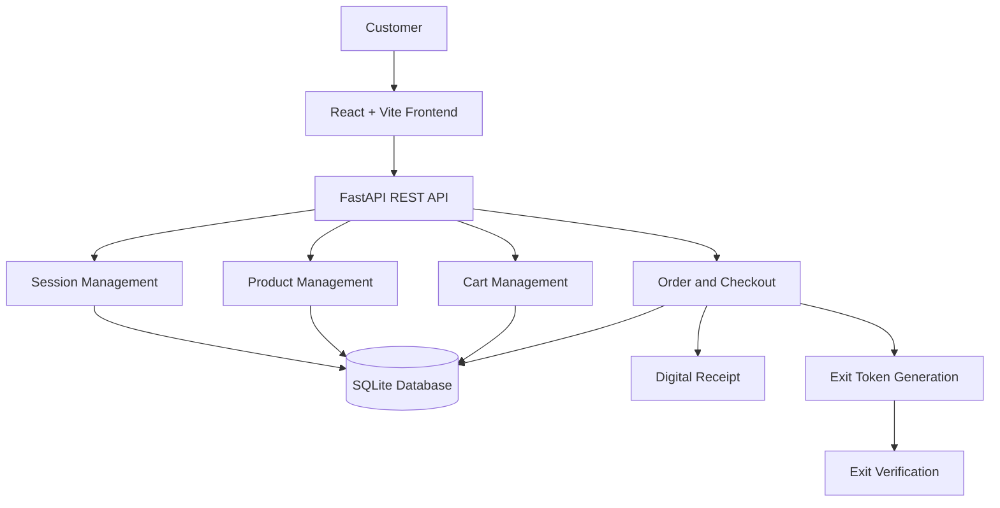

<div align="center">


<br/>


<br/>

**SCAN · COMPARE · UNDERSTAND · SHOP SMARTER**

</div>

## About SMAQR

**SMAQR — Smart Access. Intelligent Retail.**

SMAQR is a smart retail platform designed to improve the in-store shopping experience through QR-based shopping sessions, barcode-based product discovery, digital carts and a streamlined checkout process.

Our goal is to make supermarket shopping more convenient, transparent and intelligent by connecting customers and retailers through technology.

## Core Features

| Feature            | Description                                      | Status         |
| ------------------ | ------------------------------------------------ | -------------- |
| Shopping Sessions  | Create and retrieve individual shopping sessions | Implemented    |
| Product Discovery  | Find products using barcode information          | Implemented    |
| Smart Cart         | Add, update and remove products from a cart      | Implemented    |
| Stock Validation   | Check available stock when adding products       | Implemented    |
| Checkout           | Create orders and process simulated payment      | Implemented    |
| Digital Receipt    | Generate a digital order summary                 | Implemented    |
| Exit Verification  | Validate secure, single-use exit tokens          | Implemented    |
| Customer Dashboard | React-based customer portal                      | In development |

### 🚀 Future Roadmap

- [ ] Camera-based QR and barcode scanning
- [ ] Real payment gateway integration
- [ ] Customer registration and authentication
- [ ] Shopping history and spending analytics
- [ ] Store owner dashboard
- [ ] Super administrator dashboard
- [ ] AI shopping assistant
- [ ] Product price comparison
- [ ] Multilingual interface
- [ ] Multi-store support

*Roadmap features are planned and should not be considered implemented functionality.*

---

## 🛍️ How SMAQR Works

\<div align="center">

|  Step  | Shopping Process                              |
| :----: | --------------------------------------------- |
|  📱 01 | Enter the store and create a shopping session |
| 🏷️ 02 | Scan or enter a product barcode               |
|  🛒 03 | Add products and manage the shopping cart     |
|  💳 04 | Complete the simulated checkout               |
|  🧾 05 | Receive a digital receipt                     |
|  🔐 06 | Verify the exit token                         |

\</div>

---

## 🏗️ System Architecture



## 🧰 Technology Stack

| Layer            | Technology         |
| ---------------- | ------------------ |
| Frontend         | React              |
| Frontend tooling | Vite               |
| Backend          | Python             |
| API framework    | FastAPI            |
| Database         | SQLite             |
| ORM              | SQLAlchemy         |
| Data validation  | Pydantic           |
| API server       | Uvicorn            |
| Security         | SHA-256 and Fernet |
| Version control  | Git and GitHub     |

---

## 🔐 Security

SMAQR incorporates security mechanisms into its shopping workflow:

- SHA-256 hashing for exit-token verification.
- Fernet encryption for protected token data.
- Single-use exit-token validation.
- Token expiration.
- Backend-side product and stock validation.

**Note:** The current checkout uses simulated payment. Production deployment requires additional security reviews, authentication, payment integration and infrastructure hardening.

---

## ⚙️ Getting Started

### Prerequisites

- Python installed
- Node.js and npm installed
- Git installed

### 1. Clone the repository

```bash
git clone https://github.com/YOUR_USERNAME/YOUR_REPOSITORY.git
cd smart-retail
```

Replace the repository URL with your actual GitHub repository URL.

### 2. Start the backend

Open a terminal:

```bash
cd backend
```

Create and activate a virtual environment:

**Windows PowerShell**

```powershell
python -m venv venv
.\venv\Scripts\Activate.ps1
```

Install the backend dependencies using the project's dependency file:

```powershell
pip install -r requirements.txt
```

Start FastAPI:

```powershell
python -m uvicorn main:app --reload
```

Backend API:

`http://127.0.0.1:8000`

Interactive API documentation:

`http://127.0.0.1:8000/docs`

### 3. Start the frontend

Open a second terminal:

```bash
cd frontend
```

Install dependencies:

```bash
npm install
```

Start the development server:

```bash
npm run dev
```

Frontend:

`http://localhost:5173`

---

## 📁 Project Structure

```text
smart-retail/
│
├── backend/
│   ├── app/
│   │   ├── core/
│   │   ├── models/
│   │   ├── routers/
│   │   └── schemas/
│   │
│   ├── main.py
│   └── requirements.txt
│
├── frontend/
│   ├── public/
│   ├── src/
│   │   ├── components/
│   │   ├── pages/
│   │   ├── App.jsx
│   │   ├── App.css
│   │   └── index.css
│   │
│   ├── package.json
│   └── index.html
│
├── .gitignore
└── README.md
```

*This is the intended high-level structure. Actual files may differ as development progresses.*

---

## 📌 Project Status

SMAQR is currently under active development.

The backend shopping workflow has been implemented and tested. The React frontend is being developed and progressively connected to the backend API.

Our focus is building a reliable, scalable and user-friendly smart retail experience.

---

\<div align="center">

\

\<br/>

**SMAQR**

*Smart Access. Intelligent Retail.*

**Building a smarter shopping experience. 🌿**

\</div>
